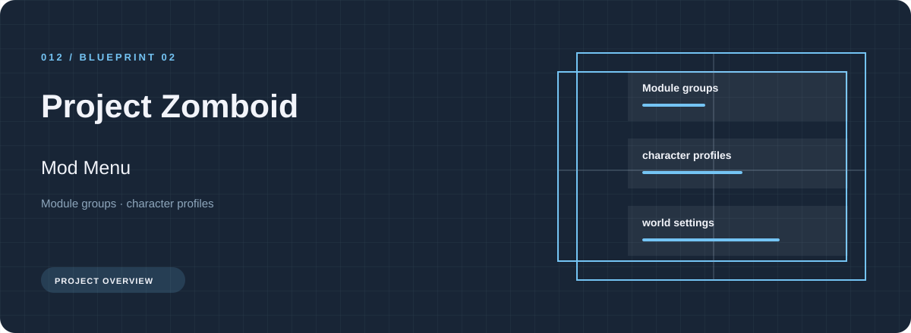
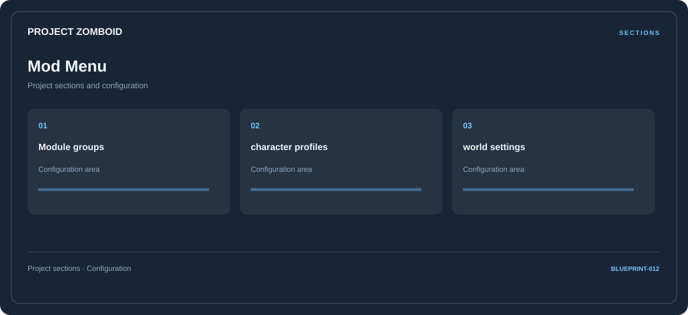

# 🛠️ Project Zomboid Mod Menu

**Module groups · Character profiles · World settings**

## ⚡ Features

Use the Project Zomboid mod menu workspace to move between module groups, character profiles, and world settings. The section map below gives each part a clear place in the project.

### ⚙️ Module groups

Content and resource groups, together with their configuration or organization details.

### 🧩 Character profiles

Related settings collected into named groups for a clearer configuration workflow.

### ⌨️ World settings

A dedicated section for world settings and the configuration details associated with that area.

## 🖥️ Project navigation

## 📥 Download

The button and cover open the project's download page. Use the information supplied with the downloaded package for installation and release-specific requirements.

## 📚 Project documentation

- [Feature reference](docs/FEATURES.md)
- [Download information](docs/DOWNLOAD.md)
- [Project page](index.html)

---

Project Zomboid Mod Menu · Program documentation and download information.
